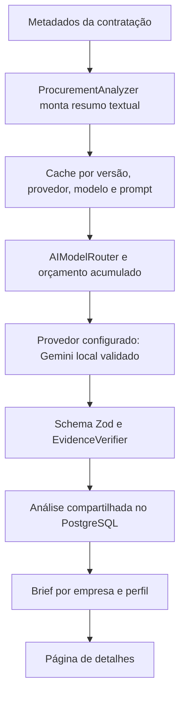

# Arquitetura de inteligência artificial

Revisão: 12/10/2026. Estado observado e evolução definida na [ADR 0007](../adr/0007-document-analysis-mvp.md) e no [escopo mínimo documental](../roadmap/document-analysis-mvp.md).

## Fluxo implementado

Chamadas podem ocorrer sob demanda HTTP ou dentro do processamento do matching. O alerta preliminar é persistido antes da análise, mas o worker ainda aguarda a IA no mesmo processamento. A fila `radar-intelligence` está declarada; não há consumidor dedicado conectado ao fluxo atual.

## Componentes existentes e limites observados

| Componente                | Implementado                                                               | Limitação                                                                                                                                                        |
| ------------------------- | -------------------------------------------------------------------------- | ---------------------------------------------------------------------------------------------------------------------------------------------------------------- |
| AIProvider / adapters     | Mock, OpenAI e Gemini; resposta estruturada validada com Zod.              | Formato válido não comprova fatos. Mock é simulação.                                                                                                             |
| AIModelRouter             | Seleção de provedor/modelo, fallback configurável e consulta de orçamento. | Ainda permite resolução para mock; a evolução deve impedir fallback operacional simulado.                                                                        |
| DocumentExtractionService | Download, unpdf, páginas e segmentação por padrões textuais.               | Não chamado pelo analisador para PDFs; falha do parser pode cair em UTF-8; não faz OCR.                                                                          |
| safeDownloadFile          | Valida URL/DNS/redirecionamentos e verifica tamanho.                       | Limite após leitura completa, timeout encerrado antes do corpo e DNS não fixado na conexão exigem correção.                                                      |
| EvidenceVerifier          | Compara citações, reclassifica requisitos sem suporte e anota riscos.      | Aceita prefixo de citação longa, ajusta páginas por aproximação e não verifica semanticamente todas as afirmações. A UI não exibe todas as notas/classificações. |
| ProcurementAnalyzer       | Analisa metadados, persiste resultado e reutiliza cache compatível.        | Não descobre documentos nem analisa edital integral; não identifica o conjunto de anexos.                                                                        |
| OpportunityBriefService   | Combina análise pública com palavras-chave, categoria e cobertura.         | Score por regras, próximos passos fixos e ausência de comprovação documental da empresa.                                                                         |
| AIUsageTracker            | Registra tokens, latência e custo estimado; compara gasto diário/mensal.   | Não reserva orçamento concorrente nem garante teto financeiro estrito.                                                                                           |

## Cache e reanálise entregues

Atualização de 12/10/2026: o cliente não pode mais forçar reanálise; botão e endpoint POST foram removidos. A opção interna de força descrita abaixo não é exposta ao assinante. Atualização de briefs é sob demanda, sem propagação ativa, e a prevenção de chamadas concorrentes ainda é pendente.

A análise concluída só é reutilizada se versão da licitação, provedor, modelo e versão de prompt coincidirem. Troca de mock para Gemini gera novo resultado; reanálise explícita força chamada. Briefs antigos são atualizados quando a análise compartilhada tem data mais recente, preservando organização e perfil.

Isso não implementa ainda atualização por hash do conjunto documental ou por mudança de perfil. A restrição única no banco evita duplicidade de registros, mas não impede chamadas concorrentes ao modelo.

## Evolução definida, ainda pendente

Entregar cinco blocos com evidências, a partir de edital e termo de referência em PDF textual. A API deve agendar trabalho e informar estado, com processamento dedicado em BullMQ. Seleção inicial sob demanda, sem baixar/analisar todos os editais coletados.

Reutilizar a análise pública por documentos/hashes e versões do pipeline. Manter briefs privados por organização/perfil, separados do cache compartilhado. Aplicar limites efetivos de download, texto, tokens, tentativas, concorrência e orçamento reservado. Cobertura parcial e falha devem ser visíveis; preservar resultado anterior sem ocultar sua desatualização.

Descoberta PNCP, extração/evidências, tela e matriz de testes estão no [plano de entrega](../roadmap/document-analysis-mvp.md). Não há novos endpoints, migrations ou contratos implementados para essa evolução nesta revisão documental.

## Segurança e interpretação

Documentos externos são dados não confiáveis. Prompts devem separar conteúdo de instruções, mas isso sozinho não garante resistência a prompt injection. Downloads exigem validação de destino e limites de recursos; o modelo não deve receber autoridade para executar instruções do edital.

Dados privados de empresas não pertencem à análise pública compartilhada. O resultado é orientação preliminar com evidências e lacunas, não parecer jurídico ou garantia de habilitação. Aderência comercial, cobertura documental e qualidade da evidência são medidas distintas.
