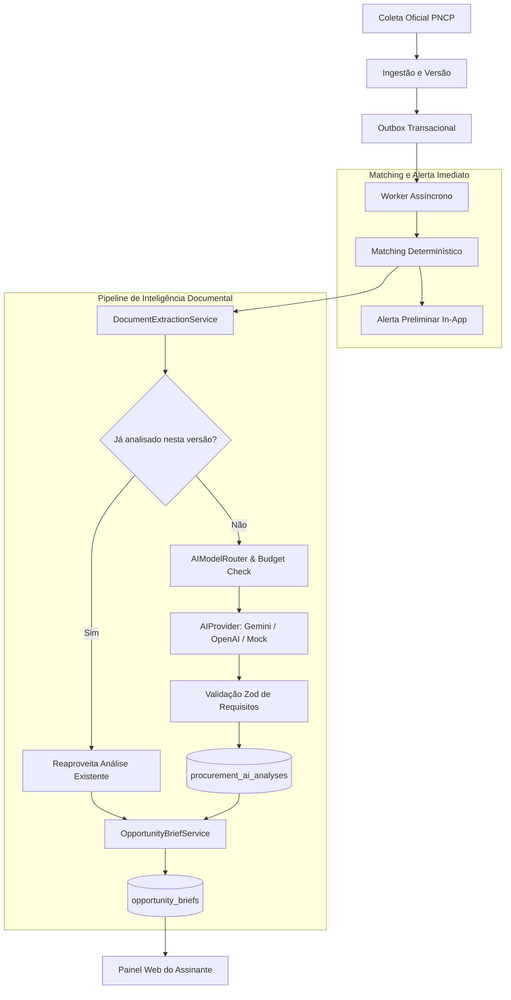

# Arquitetura de Inteligência Artificial — Radar Inteligente

## 1. Visão Geral

A camada de inteligência artificial do Radar de Licitações Públicas foi projetada para transformar editais governamentais extensos e complexos em **Opportunity Briefs personalizados e acionáveis** para os fornecedores.

---

## 2. Componentes e Responsabilidades

### 2.1. `AIProvider` (Interface de Provedores)
Abstração padronizada para invocar modelos de linguagem com saída JSON Schema estrita:
- `MockAIProvider`: Execução local determinística com latência zero e custo nulo.
- `OpenAIProvider`: Chamadas HTTP oficiais com cabeçalhos de autenticação, timeout e formato estruturado `json_schema`.
- `GeminiProvider`: Chamadas oficiais REST para a família de modelos Gemini da Google.

### 2.2. `AIModelRouter` (Roteamento Dinâmico e Resiliência)
- Seleciona o modelo com base no tipo de tarefa (`document.requirements_extraction`, `opportunity.brief_generation`, `procurement.classification`).
- Realiza failover automático para o provedor configurado em `AI_FALLBACK_PROVIDER` caso o primário responda com erro temporário de rate limit (429) ou erro de servidor (5xx).
- Valida o orçamento com o `AIUsageTracker` antes de disparar chamadas pagas.

### 2.3. `DocumentExtractionService` (Pipeline Documental)
- Baixa e segmenta o edital em seções temáticas (Objeto, Habilitação, Prazos, Execução, Sanções).
- Gera hash estável do conteúdo para detecção de duplicidades.
- Aplica salvaguarda contra SSRF (`assertApprovedUrl`).

### 2.4. `ProcurementAnalyzer` (Análise de Requisitos)
- Constrói prompts estruturados com instruções explícitas de mitigação de prompt injection.
- Valida e persiste os requisitos fáticos extraídos em `procurement_ai_analyses`.
- Garante o **processamento compartilhado**: a mesma versão de edital é analisada apenas uma vez, independentemente de quantas empresas a receberem.

### 2.5. `OpportunityBriefService` (Brief Personalizado)
- Cruza a análise documental pública com o perfil comercial privado da empresa (palavras-chave, categorias e cobertura geográfica).
- Produz uma pontuação de aderência comercial (0 a 100), nível de compatibilidade, justificativas, pontos fortes, lacunas e próximos passos sugeridos.
- Salva o brief isolado em `opportunity_briefs` com chave única por `(organizationId, profileId, procurementId)`.

### 2.6. `AIUsageTracker` (Auditoria e Custos)
- Registra cada invocação de IA em `ai_usage_records` com tokens de entrada/saída, latência e custo calculado em USD.
- Bloqueia novas chamadas se o gasto do dia ou do mês exceder os limites configurados (`AI_DAILY_BUDGET_USD` / `AI_MONTHLY_BUDGET_USD`).

---

## 3. Segurança e Governança

1. **Isolamento de Dados:** Dados privados do perfil comercial nunca são enviados para modelos sem garantia de privacidade; o edital analisado é um documento público.
2. **Defesa contra Prompt Injection:** O conteúdo textual do edital é demarcado como dados brutos e instruções contidas no edital não têm capacidade de alterar as regras do sistema.
3. **Fidelidade Fática:** O prompt instrui expressamente o modelo a omitir ou marcar como `not_found` qualquer dado ausente, proibindo a invenção de atestados ou exigências inexistentes.
4. **Isenção Legal:** Todo Opportunity Brief acompanha aviso de isenção de que a análise é preliminar e não constitui parecer jurídico.
