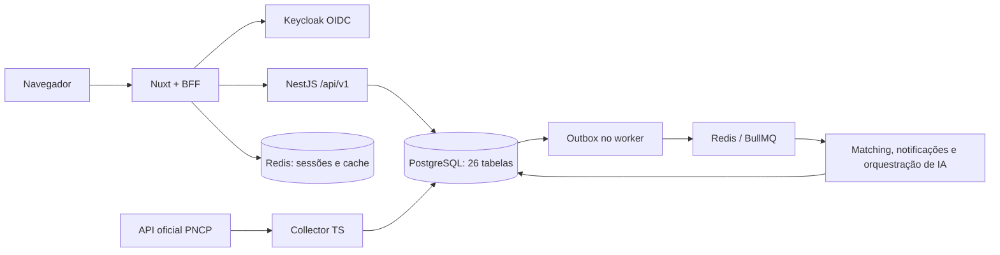

# Arquitetura do MVP

Monorepo TypeScript strict com pnpm/Turborepo. A API NestJS é um monólito modular. Nuxt 4 oferece páginas públicas, SSR privado e um BFF de mesma origem. Collector e worker são processos da mesma plataforma, não microsserviços de domínio independentes.

Pacotes compartilhados: contracts (schemas Zod e estratégia determinística pura), database (schema/migrations/conexão), source-sdk (fronteira de conectores e segurança SSRF), events (eventos versionáveis), config (ambiente/logs/telemetria) e document-intelligence (adapters multi-provider de IA, router, pipeline documental e Opportunity Briefs). Dependências são unidirecionais; pacotes não importam aplicações. Rotas Nuxt são adaptadores de componentes de tela, com contratos acessados pelo BFF.

O isolamento se baseia em `organizations.id`, associação validada pela API e predicados explícitos. O catálogo de licitações é global. O banco usa uma credencial técnica local; RLS não foi implementado e não é alegado como proteção adicional.

A referência de implementação segue [Nuxt 4](https://nuxt.com/docs/4.x/getting-started/introduction), [openid-client](https://github.com/panva/openid-client) e a [API oficial de consulta PNCP](https://pncp.gov.br/api/consulta/swagger-ui/index.html).

Este repositório é o esqueleto funcional solicitado, com fluxo vertical real. Os limites comerciais e operacionais restantes estão em `docs/roadmap/mvp.md`. Não é uma declaração de prontidão para produção paga.
