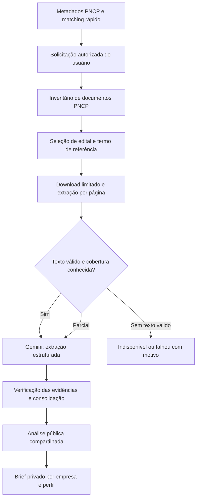

# MVP de análise documental: resumo de decisão com evidências

Data: 12/10/2026. Estado: **NOT_STARTED** para a integração documental ponta a ponta. Este documento define a próxima entrega; não representa funcionalidade já disponível. Decisão arquitetural: [ADR 0007](../adr/0007-document-analysis-mvp.md).

## Objetivo e situação atual

Ajudar o fornecedor a decidir se vale aprofundar uma oportunidade e identificar o que precisa conferir antes de participar. A utilidade vem de fatos verificáveis e cobertura explícita, não de um texto longo ou de uma promessa de habilitação.

Hoje o Gemini analisa metadados cadastrados. O parser PDF, o download e a segmentação existem, mas não estão ligados ao ProcurementAnalyzer. A pontuação comercial é calculada por regras; não mede qualidade documental, habilitação ou probabilidade de vitória.

## Entrega mínima ao usuário

| Bloco                          | Conteúdo                                                                                        |
| ------------------------------ | ----------------------------------------------------------------------------------------------- |
| Objeto e escopo                | O que fornecer, itens/lotes e quantidades quando identificáveis no texto.                       |
| Prazos                         | Proposta, entrega e execução expressamente encontrados; preservar condições e redação da fonte. |
| Exigências de participação     | Documentos de habilitação, atestados, registros e amostras explicitamente exigidos.             |
| Condições operacionais         | Local de entrega, obrigações relevantes e condições de pagamento encontradas.                   |
| Pontos de atenção e pendências | Divergências, exigências para conferência e informações não localizadas.                        |

Cada achado deve conter documento, página, trecho de origem e classificação: evidenciado, inferência ou não localizado. Uma citação deve sustentar a afirmação, não apenas conter palavras parecidas. Ausência no texto analisado não equivale a inexistência de exigência.

Exibir documentos encontrados, selecionados, lidos e pendentes, páginas não legíveis, data da execução, versão documental e provedor/modelo. Links devem permitir conferir o documento e a página citada. Manter cobertura documental separada de aderência comercial.

## Escopo e exclusões

- Processar edital e termo de referência em PDF textual, mediante solicitação do usuário autenticado e autorizado para a organização.
- Inventariar os demais documentos. Retificação, anexo essencial não lido ou página ilegível exige indicação explícita de cobertura parcial; não chamar o resultado de análise integral.
- Arquivo ausente, bloqueado, excedente ao limite ou de formato não suportado deve ter motivo visível.
- Não incluir OCR, planilhas/tabelas complexas, parecer jurídico, detecção conclusiva de ilegalidade, comprovação documental da empresa, probabilidade de vitória, precificação, concorrentes ou chat livre.
- Não adicionar banco vetorial, novo runtime ou microsserviço para este incremento. Reutilizar TypeScript, PostgreSQL, BullMQ e os componentes existentes.

## Fluxo proposto

A API agenda o trabalho e retorna seu estado; não espera a chamada ao modelo. Consumir a fila de inteligência separadamente do matching. O matching e os alertas preliminares devem continuar disponíveis durante uma falha documental.

## Etapas e critérios de aceite

### 1. Descoberta e identidade documental

- Validar a resposta real da listagem PNCP; não assumir o envelope do JSON ilustrativo.
- Persistir CNPJ do órgão, ano e sequencial da contratação de forma explícita.
- Registrar identidade do documento, título, tipo, URL, data de publicação, última consulta e estado de processamento.
- Conferir respostas vazias, indisponibilidade, redirecionamento e formato inesperado.
- Aceite: uma contratação real tem inventário rastreável, sem registros fictícios e sem baixar tudo indiscriminadamente.

### 2. Download e extração confiáveis

- Aplicar limite de bytes durante a leitura, timeout até o fim do corpo, validação de formato e destinos aprovados em cada redirecionamento. Vincular a resolução DNS validada à conexão efetiva.
- Preservar identidade, hash dos bytes, hash do texto, páginas e versão do extrator. Definir armazenamento privado dos arquivos originais e política de retenção antes da implementação.
- PDF inválido não pode virar texto por decodificação UTF-8. Página sem texto legível fica pendente; não encaminhar lixo binário ao modelo.
- Aceite: PDF textual produz texto por página; escaneado, corrompido, externo bloqueado e arquivo excedente produzem estados explicáveis, sem análise falsamente concluída.

### 3. Análise e evidências

- Fazer uma chamada estruturada para conteúdo dentro do orçamento. Para conteúdo maior, dividir por documento/seção e limite de tokens; consolidar preservando referências. Não truncar silenciosamente nem analisar apenas os primeiros trechos.
- Verificar citação completa no documento/página correto; não aceitar prefixo curto como comprovação nem corrigir página inválida por aproximação.
- Não dar ao conteúdo externo autoridade para executar ferramentas ou modificar instruções. Schema válido não comprova correção factual.
- Aceite: os cinco blocos possuem fatos rastreáveis e pendências explícitas; divergências não são resolvidas arbitrariamente pela IA.

### 4. Fila, cache, orçamento e interface

- Estados de experiência: aguardando, processando, concluída, parcial e falhou. Separar estado de execução, cobertura documental e atualidade do resultado; os contratos definitivos serão definidos na implementação.
- Falha deve preservar a última análise válida, identificada como anterior quando necessário. Nunca retornar mock como fallback de uma análise real.
- Chave de reutilização: contratação + conjunto ordenado de documentos/hashes + versão do extrator + prompt/schema + provedor/modelo. Documento incluído, substituído ou removido deve invalidar o resultado pertinente.
- Reconsultar o inventário segundo política de atualização; hash só identifica mudança depois de verificar a fonte. Reaproveitar extrações por hash antes de gastar tokens novamente.
- Proteger jobs concorrentes com identidade idempotente/lock. Unicidade no banco sozinha não evita duas chamadas pagas simultâneas.
- Compartilhar apenas análise documental pública. Brief privado deve referenciar a análise compartilhada e a versão do perfil, com autorização e filtros de organização.
- Aceite: dois assinantes reutilizam a mesma análise pública sem nova inferência; refresh da página não gera cobrança; mudança documental gera nova execução; falha da IA não interrompe o radar.

## Controle de custo

- Primeiro incremento sob demanda. Análise automática após matching permanece fora deste escopo e deve ser habilitada somente após medição; o comportamento atual do worker precisará ser ajustado.
- Limitar documentos, bytes, páginas/trechos, entrada e saída de tokens, concorrência, tentativas e frequência de reanálise manual. Exibir cobertura parcial quando um limite impedir o processamento.
- Reservar orçamento antes das chamadas concorrentes e conciliar com consumo real. Registrar custo estimado como estimativa, sem tratá-lo como faturamento do provedor.
- Escolher limites e orçamento por oportunidade após medir uma amostra representativa; valores numéricos e política de retenção estão pendentes, não são garantias de operação.
- Não enviar dados privados de empresas na extração pública compartilhada. Personalização inicial pode continuar determinística, sem nova chamada ao modelo.

## Validação de qualidade e liberação

Preparar amostra de editais reais revisados manualmente: edital com termo de referência, múltiplos anexos, retificação, PDF escaneado, corrompido, tabela extensa e documento indisponível. Identificar claramente fixtures de testes.

Medir requisitos relevantes omitidos, afirmações sem suporte, precisão de documento/página/citação, cobertura de leitura, latência e tokens/custo por contratação. Definir limiares de aceite antes da homologação; testes de JSON válido não substituem essa avaliação.

Testar também autorização por tenant, deduplicação concorrente, reutilização entre empresas, alteração de anexo sem mudança dos metadados, timeout/429, esgotamento de orçamento e indisponibilidade do Gemini sem retorno mock.

**Aceite final:** o usuário solicita a análise, recebe os cinco blocos com evidências conferíveis, identifica tudo que ficou de fora e consulta o resultado novamente sem nova chamada paga.

## Evolução posterior

1. Consolidar anexos adicionais e retificações, com comparação entre versões.
2. Adicionar OCR seletivo, tabelas e formatos adicionais com métricas de qualidade.
3. Comparar requisitos com documentos/capacidades da empresa, preservando privacidade e indicando verificações humanas pendentes.

## Fontes oficiais e pendências de homologação

- [PNCP v2.6: listar documentos](https://pncp.gov.br/manual/pt-br/latest/contratacao/consultar_todos_documentos_de_uma_contratacao.html): `GET /v1/orgaos/{cnpj}/compras/{ano}/{sequencial}/arquivos`.
- [PNCP v2.5: baixar documento](https://pncp.gov.br/manual/pt-br/2.5/contratacao/baixar_documento_de_uma_contratacao.html): `GET /v1/orgaos/{cnpj}/compras/{ano}/{sequencial}/arquivos/{sequencialDocumento}`.

Documentação consultada em 12/10/2026. Base efetiva, envelope, tipos e comportamento HTTP serão homologados na API em execução durante a primeira etapa. Não há board externo identificado; as etapas acima são planejamento técnico, sem IDs de tarefas inventados.
